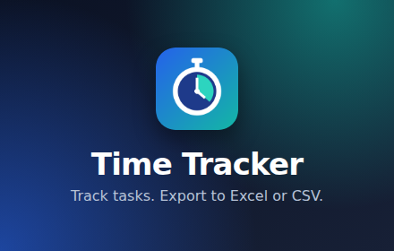
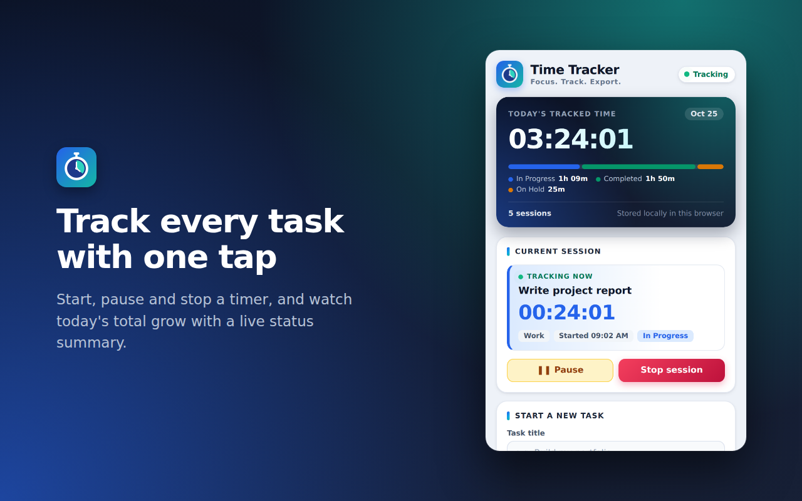
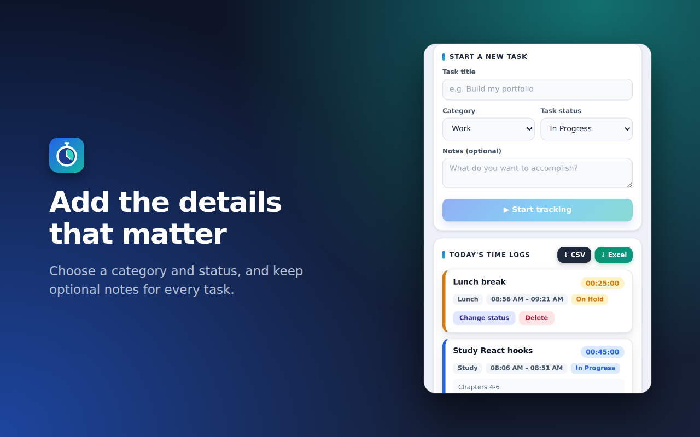
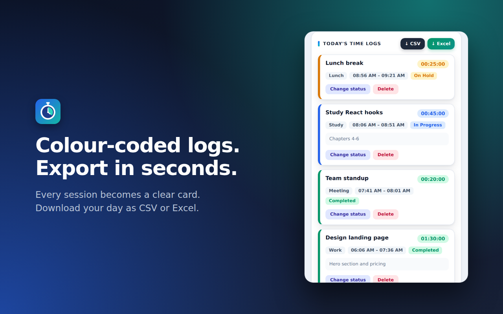
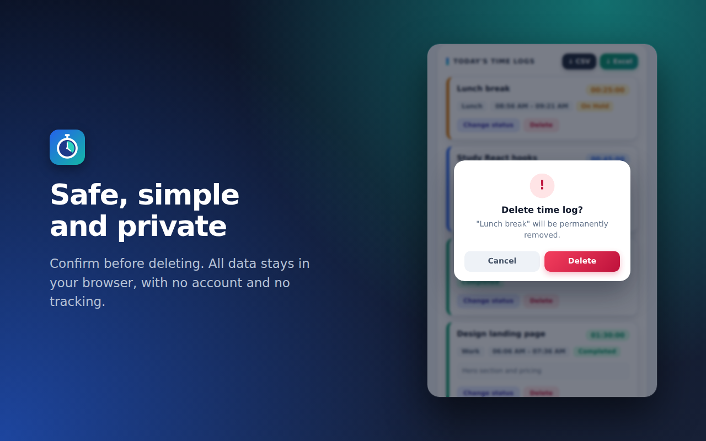

# ⏱️ Time Tracker — Chrome Extension

A lightweight Chrome extension that helps you track what you work on, see where your day goes, and export your time logs to **CSV** or **Excel**. Everything is stored locally in your browser. No account, no server, no tracking.



---

## Table of contents

1. [About the project](#about-the-project)
2. [Features](#features)
3. [Installation](#installation)
4. [How to use](#how-to-use)
5. [Export formats](#export-formats)
6. [Project structure](#project-structure)
7. [Tech stack and how it works](#tech-stack-and-how-it-works)
8. [Screenshots](#screenshots)
9. [Data and privacy](#data-and-privacy)
10. [Contributing](#contributing)
11. [License](#license)

---

## About the project

People who juggle several tasks a day, such as freelancers, students, developers and office workers, often lose track of where their time goes. Time Tracker is a small, private timer that lives in your browser toolbar. Start a task, pause it when you are interrupted, stop it when you are done, and at the end of the day download a clean report.

It is built with plain HTML, CSS and JavaScript on Chrome's Manifest V3. There are no frameworks, no build step and no dependencies.

---

## Features

**Timer**
- Start, pause, resume and stop a task timer. Paused time is never counted.
- The timer keeps running when the popup is closed, because it is based on timestamps rather than on the popup being open.
- One task runs at a time.

**Task details**
- Title and optional notes.
- Categories: Work, Study, Development, Meeting, Break, Lunch, Personal, Other.
- Statuses: In Progress, Not Started, Completed, On Hold.

**Today at a glance**
- Total tracked time for the day, including the running session.
- Session count and today's date.
- A colour bar and legend showing how your time splits across statuses.
- A header badge showing Idle, Tracking or Paused.

**Today's time logs**
- One card per session with title, duration, category, start and end time, status and notes.
- Card colour is driven by status: blue for In Progress, green for Completed, amber for On Hold, slate for Not Started.
- Change a log's status or delete it.
- Deleting a log or clearing the day asks for confirmation in a built-in dialog.

**Export**
- Download today's report as **CSV** or **Excel (.xlsx)**.
- The Excel file has auto-fitted columns, a styled header row, a frozen header and filters.
- A running session is included and marked Running or Paused.

**Other**
- Toast notifications that stay visible wherever you scroll and dismiss themselves.
- A badge on the toolbar icon: a green dot while tracking, an amber `II` while paused.
- Custom logo and a thin, unobtrusive scrollbar.

---

## Installation

1. Download or clone this repository.
   ```bash
   git clone https://github.com/<your-username>/time-tracker-extension.git
   ```
2. Open Chrome and go to `chrome://extensions`.
3. Turn on **Developer mode** (top-right).
4. Click **Load unpacked** and select the folder that contains `manifest.json`.
5. Click the puzzle icon in the toolbar and pin **Time Tracker**.

It also works in other Chromium browsers such as Edge, Brave and Opera.

If you edit the code, click the reload icon on the extension's card in `chrome://extensions` and reopen the popup.

---

## How to use

1. **Start a task.** Enter a title, choose a category and status, add optional notes, and press **▶ Start tracking**.
2. **Pause or resume** from the *Current session* card.
3. **Stop** with **Stop session**. The session is saved to *Today's time logs*.
4. **Manage logs.** Use **Change status** to update a log, or **Delete** to remove it after confirming.
5. **Export.** Press **↓ CSV** or **↓ Excel** to download today's report.
6. **Clear the day.** Press **Clear today's logs** at the bottom and confirm. Stop any running session first.

---

## Export formats

Both formats contain one row per session for today, oldest first.

| Column | Example |
|---|---|
| Task Title | Build my portfolio |
| Category | Development |
| Date | 2026-10-25 |
| Start Time | 10:45:12 AM |
| End Time | 11:30:40 AM |
| Duration (HH:MM:SS) | 00:45:28 |
| Duration (Minutes) | 45.47 |
| Task Status | Completed |
| Session State | Stopped / Running / Paused |
| Notes | Landing page |

**CSV** is UTF-8 with a byte-order mark so Excel reads special characters correctly. Date, time and duration columns are written as text so Excel displays them exactly as shown above.

**Excel (.xlsx)** is a real workbook with columns sized to fit their content, a bold header on a blue fill, a frozen header row and filter buttons.

In both formats, text that begins with `=`, `+`, `-` or `@` is prefixed with `'` so it cannot run as a spreadsheet formula.

---

## Project structure

```
time-tracker-extension/
├── manifest.json      # Extension config (Manifest V3), permissions, icons
├── background.js      # Service worker: toolbar badge (running / paused)
├── popup.html         # Popup markup, toast and confirmation dialog
├── popup.css          # Styling and design system
├── popup.js           # App logic: timer, storage, rendering, export
├── icons/
│   ├── icon16.png
│   ├── icon32.png
│   ├── icon48.png
│   ├── icon128.png
│   └── icon.svg       # Vector version of the logo
├── screenshots/
│   └── preview.png
├── README.md
├── LICENSE
└── .gitignore
```

---

## Tech stack and how it works

| Layer | Choice |
|---|---|
| Platform | Chrome Extension, Manifest V3 |
| Markup and styling | HTML5 and plain CSS with custom properties |
| Logic | Vanilla JavaScript |
| Storage | `chrome.storage.local` |
| Background | Manifest V3 service worker |
| Export | Hand-written CSV and XLSX writers, no libraries |

**State.** The popup keeps one object and saves it after every change:
```js
data = { logs: [ ...finishedSessions ], active: currentSession | null }
```

**Accurate timing.** The active session stores `startAt`, `resumedAt` and `accumulatedMs`. While running, elapsed time is `accumulatedMs + (now - resumedAt)`. Pausing folds the elapsed time into `accumulatedMs`. This stays correct when the popup closes, the computer sleeps or the browser restarts.

**Local days.** A session belongs to the calendar day, in your local time zone, on which it started.

**Efficient rendering.** The timer and summary refresh every second, while the list of log cards is rebuilt only when its data changes, so hover effects and clicks are never interrupted.

**Status colours.** A `data-status` attribute sets two CSS variables, so a card's stripe, duration pill and status chip always share one colour.

**Dialogs and messages.** A promise-based confirmation dialog handles destructive actions, and one shared toast shows all feedback, so no browser `alert` or `confirm` boxes are used.

**Excel export.** An `.xlsx` file is a ZIP of XML files. The extension writes the XML itself and packs it with a small ZIP writer that includes a CRC-32 checksum, so no third-party library is needed.

**Permissions.** Only `storage`. There are no host permissions and no network access.

---

## Screenshots






---

## Data and privacy

- All data stays in your browser's local extension storage.
- The extension makes no network requests and loads no remote code.
- Data is not synced between devices.
- Removing the extension deletes its data. Export first if you want a copy.

---

## Contributing

1. Fork the repository.
2. Create a branch: `git checkout -b feature/my-feature`
3. Commit your changes: `git commit -m "Add my feature"`
4. Push: `git push origin feature/my-feature`
5. Open a Pull Request.

Please keep the project dependency-free and test in Chrome before submitting.

---

## License

Released under the [MIT License](LICENSE).
